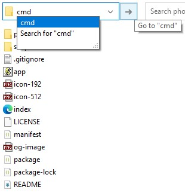

# photo-collage

Шаблон фотоколлажа для телевизора.
Кладёте фото фотосессии в папку — запускаете `npm start` — получаете
готовую страницу-коллаж: раскладки под портретные и альбомные кадры,
навигация пультом.

Без сборочных фреймворков: страница — чистый ES5-JavaScript (работает
в старых Android WebView ~2014 года), сборка — один Node-скрипт.

## Показ на телевизоре с флешки

Страница — статические файлы без внешних зависимостей (никаких CDN,
шрифтов, fetch): фото грузятся по относительным путям, поэтому готовая
галерея работает прямо с флешки (`index.html` через `file://`),
без интернета.

Как собрать свою галерею и показать её на ТВ (шаги выполняются
в папке распакованного репозитория; если вы читаете это на GitHub —
скачайте архив: зелёная кнопка **Code → Download ZIP**, git не нужен):

1. Установите Node.js 14+ с [nodejs.org](https://nodejs.org) — кнопка
   **LTS**, ставится один раз.
2. Удалите демо-фото из `photos-src/` и положите свои: jpg/png,
   любые размеры, портретные и альбомные вперемешку.
3. Откройте папку в терминале — в Проводнике кликните по адресной
   строке, напишите `cmd` и нажмите Enter (см. картинку) — и выполните
   по очереди:

   ```sh
   npm install
   npm run build
   ```

   В папке появятся `photos_mid/`, `photos_thumb/`, `config.js`,
   `version.js`. Проверить коллаж можно сразу: откройте `index.html`
   двойным кликом — сервер не нужен.

   
4. Скопируйте на флешку файлы из таблицы ниже — не переименовывая
   и сохраняя структуру: `index.html` лежит рядом с `photos_mid/`
   и `photos_thumb/`, а не внутри них.
5. Вставьте флешку в ТВ и откройте в браузере **index.html**.
   На Android TV браузер ставится из Google Play (Chrome, Firefox,
   TV Bro) — встроенные медиаплееры Smart TV HTML-страницы обычно
   не открывают.

| Что взять на флешку | Зачем |
|---|---|
| **index.html** | **главный файл — именно его открыть на ТВ** |
| app.js | движок коллажа |
| config.js | список фото и настроек |
| version.js | версия сборки |
| manifest.json, icon-192.png, icon-512.png | манифест и иконки |
| photos_mid/, photos_thumb/ | каталоги фото: полные и миниатюры |

**Если что-то пошло не так.** Красная полоса «Ошибка: …» на ТВ —
нарушена структура папок на флешке (сверьтесь с таблицей).
«npm не является командой» — переустановите Node.js и откройте
терминал заново.

## Управление

**Пульт (и клавиатура):**

- стрелки — листать страницы (вправо/вниз — вперёд, влево/вверх — назад);
- 1–4 — раскладки:
  - **1 «змейка»** — слева портретное фото на всю высоту, справа альбомное, под ним панель с эскизами соседних страниц; если портретных фото нет, левая секция показывает альбомное и растёт до равенства с правой, пока панель управления умещается без переполнения;
  - **2** — портрет во всю высоту и две альбомные стопкой справа;
  - **3** — два столбца: экраны из двух портретов и из двух альбомных чередуются;
  - **4** — каждое фото на весь экран, вписано целиком без обрезки;
- P или пробел — пауза / продолжить.

## Запуск на компьютере

Нужен [Node.js](https://nodejs.org) 14+ (кнопка **LTS**) — поставьте,
если ещё не установлен. Сборка проверена на Node 22.

```sh
# 1. положить фото фотосессии в photos-src/ (jpg/png, любые размеры)
# 2. установить зависимости и собрать:
npm install
npm run build
```

В репозитории лежит несколько демо-фото — удалите их и положите свои.
Затем просто откройте `index.html` двойным кликом: коллаж работает
из папки, без сервера и интернета.

Сервер нужен, только когда страницу смотрят с другого устройства —
например, с телевизора по локальной сети:

```sh
npm start          # сборка (инкрементально) + сервер на 8080
```

На компьютере откройте `http://localhost:8080`, на ТВ —
`http://IP-компьютера:8080`.

Что делает `npm run build` — из `photos-src/` создаются `photos_mid/`
(полные копии ~1600px), `photos_thumb/` (миниатюры ~400px) и
`config.js` — карта фото с ориентацией и отношением сторон
(`o: 'p'/'l'`, `r: w/h`). Повторный запуск обновляет только
изменившиеся файлы.

## Лицензия

MIT — см. [LICENSE](LICENSE).
